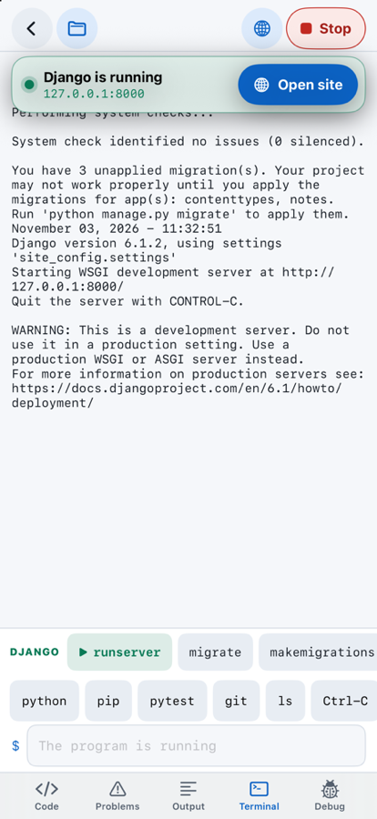
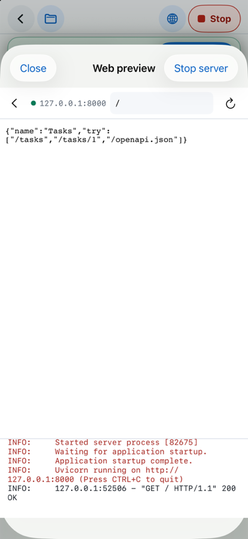
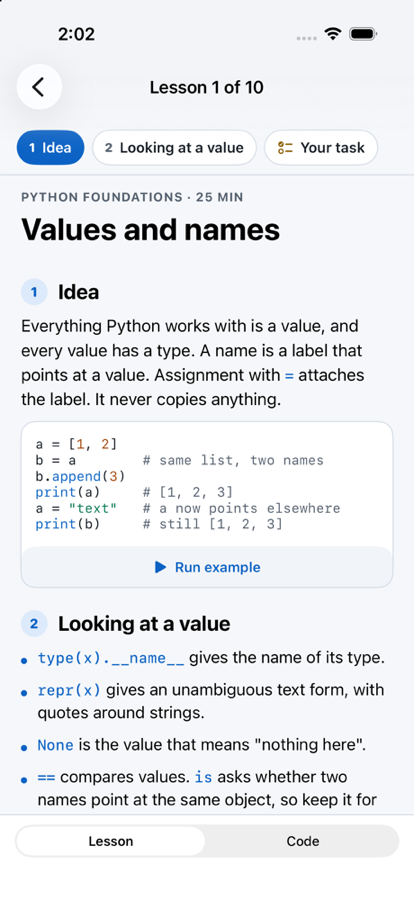
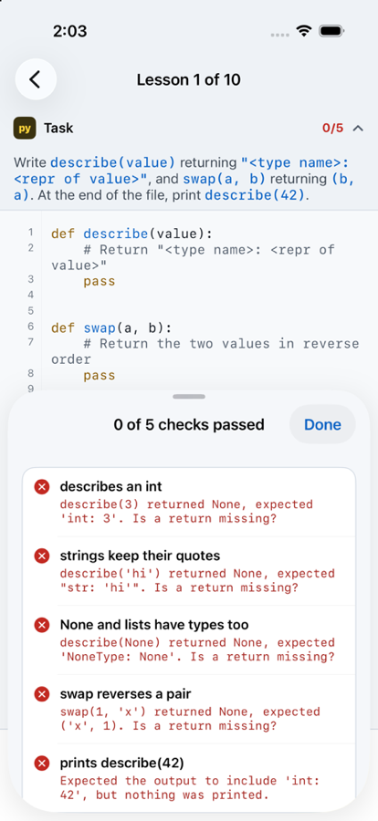
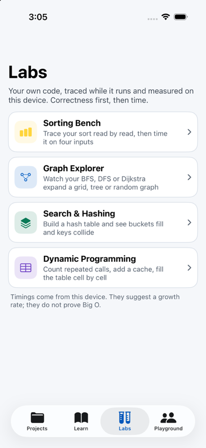
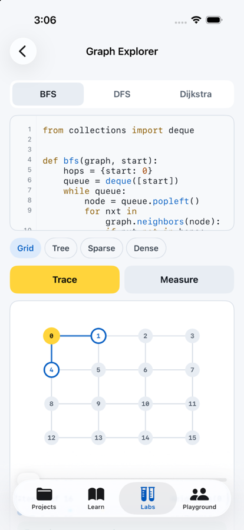
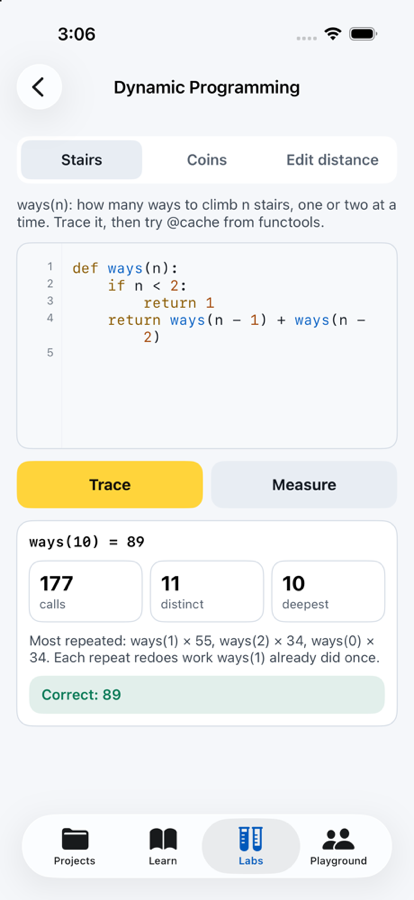
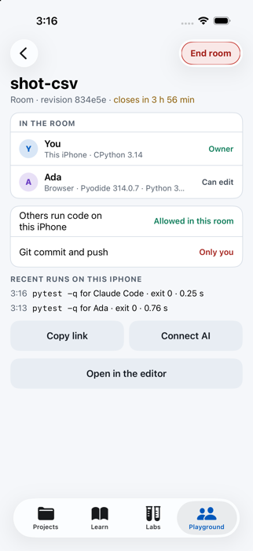

# Pythilo

**Real Python on your iPhone and iPad.** Pythilo is an IDE, a course and 32 interactive
algorithm and machine learning labs in one app. CPython 3.14 runs on the device itself: your code, your
tests, your Django site and your debugger session never leave the phone, and none of
it needs a network.

Pythilo is a paid app, in TestFlight now. This repository is public to read; it is not
open source (see [License](#license)).

<p align="center">
  
  
  
  
</p>
<p align="center">
  
  
  
  
</p>

## What it does

### A real workspace

- **CPython 3.14.10, embedded.** Not a web view, not a cloud box: the interpreter
  ships in the app, with `input()`, real files, tracebacks that point at your line,
  and a Stop that works on endless loops, `sleep`, blocking sockets and asyncio.
- **Projects with many files**, a file drawer with nested folders, an editor built
  for touch, a terminal and a problems list fed by pyflakes, with Jedi
  completion that knows your own modules.
- **Run web servers on the phone.** Django with SQLite and migrations, Flask, FastAPI
  with Pydantic, Starlette on Uvicorn. When a server starts, Pythilo says so and opens
  the site in a preview where you can go to any path, such as `/admin/`. The
  framework's own commands (`runserver`, `migrate`, `flask run`, `uvicorn main:app`)
  sit one tap away in the terminal.
- **A debugger** with breakpoints, stepping and variables, which also stops inside
  threads, web request handlers and async code.
- **Tests and packages.** pytest runs as it would on a computer. pip installs
  pure-Python packages from PyPI into the project; NumPy and the web frameworks come
  bundled.
- **Git, for real.** A genuine `.git` folder: commit, branches, diff, `git merge` with
  conflict markers and `--abort`, `git rebase`, and HTTPS clone.
- **Notebooks** that open and save ordinary `.ipynb` files.
- **npm and React.** `npm install` fetches packages from the npm registry and checks
  each one's integrity; `npm run build` bundles with esbuild, which runs inside the app.
  A React and FastAPI template installs, builds and serves its site on the device.
- **Core ML from Python.** `pythilo.coreml` runs a converted model on the CPU, the GPU
  or the Neural Engine, times each one and checks they agree.

### Learn

- **382 lessons in 30 courses** (including 74 advanced lessons and six integration projects): Python foundations and Python deeper (30 each), clean
  code, testing, the tools around Python, architecture, concurrency and async, the web,
  data, the mathematics of neural networks, machine learning with PyTorch (30), language
  models from the inside, working with AI tools, and four practical courses on
  algorithm patterns, data processing, reliability and machine learning, followed by
  ML evaluation and AI building blocks. New courses cover Pydantic 2 (20 lessons),
  FastAPI/HTTPX (14), practical testing (10) and file/data formats (8).
  Plus **100 interview tasks** (35 easy, 45 medium, 20 hard) with a timer, progressive
  hints, worked solutions and edge-case checks.
- PyTorch 2.15 runs on the device ([torch-ios](https://github.com/sergii-ziborov/torch-ios)):
  the machine learning lessons train real networks offline.
- Every exercise is checked by running your code on the device. When a check fails it
  says what happened: `describe(3) returned None, expected 'int: 3'. Is a return missing?`
- Reading and coding take turns on the whole screen on a phone, and sit side by side on
  an iPad.

### Labs

72 labs that trace **your own code** while it runs, with scaling measurements where
available. Thirty also run in the browser at [pythilo.com/labs](https://pythilo.com/labs/),
using the same tracer and correctness checks.
Correctness first, then time. The catalogue now covers Basics, Data structures,
Algorithms, Machine learning and Artificial intelligence. Search the catalog or use
the ML (33 labs) and AI (16 labs) filters. For example:

- **ML evaluation and optimization**: train-only standardization, confusion matrices,
  precision/recall/F1, threshold selection, folds, ridge regression, gradient checks,
  Adam, mini-batch SGD, Naive Bayes, PCA and silhouette scores.
- **AI building blocks**: stable softmax and temperature, scaled dot-product attention,
  causal masks, nucleus candidates, beam search, BPE merging, cosine retrieval and
  layer normalization.

- **Sorting Bench**: every read and write your sort makes, on four kinds of input.
- **Graph Explorer**: your BFS, DFS or Dijkstra expanding a grid, tree or random graph,
  step by step. A DFS is judged as a valid depth-first order, not one fixed answer.
- **Search & Hashing**: build a hash table and watch buckets fill and keys collide;
  comparisons are counted by the keys themselves.
- **Dynamic Programming**: how many calls a recursion repeats, what a cache saves, and
  a table filling cell by cell.

### Work with others, and with AI

- **An AI client on your computer** (Claude, Codex or any MCP client) can work on one
  project over your local network. Reading, editing, running, installing packages and
  committing are separate permissions, and every write checks that the file has not
  changed underneath it.
- **Shared rooms** put a project in front of a browser or an AI client by link, with
  live edits and cursors, end-to-end encrypted so the relay only sees ciphertext. Code
  runs where someone asks it to, and every result says where: this browser, or an
  iPhone whose owner allowed it. The relay is live at https://pythilo.com.
- **A website** with the same lessons running in the browser on Pyodide, a playground
  and rooms. Live at [pythilo.com](https://pythilo.com), with the guide, pricing, support and legal pages.
- **A practical blog** at [pythilo.com/blog](https://pythilo.com/blog/), with tested
  Python examples and direct links into the ML and AI lessons and labs.

### Every shape

Layouts for the iPhone held either way, the iPad with or without a keyboard, and the
folding iPhone in each of its poses. On a phone the IDE uses the whole screen: buttons
sit beside the camera, and code runs to the bottom edge.

## What it does not do (yet)

- No pandas, Matplotlib or SciPy: nobody publishes iOS builds of them for Python 3.14
  ([details](docs/research/ml-on-ios.md)).
- PyTorch trains on the CPU only: no MPS, no `torch.compile`, one process. The Neural
  Engine is reached through Core ML (`pythilo.coreml`).
- No Node: npm installs packages and esbuild builds them, but Node tools such as Vite
  or webpack cannot run on an iPhone.
- Compiled packages work only when Pythilo bundles them; pip installs pure Python.
- No Jupyter server: notebooks run on Pythilo's own kernel.
- iOS pauses apps in the background, so a server runs while Pythilo is open.

[`docs/STATUS.md`](docs/STATUS.md) lists what is done, how it was checked, and what is
missing, item by item.

## How it is built

| Part | What it is |
| --- | --- |
| `Pythilo/Runtime` | The C host and Swift session around the embedded interpreter |
| `Pythilo/PythonRuntime/pythilo_runtime` | The Python side: runner, terminal, debugger, pip, analysis, notebooks, lessons, labs |
| `Pythilo/Projects` | Project folders, the open workspace, Git commands, framework commands |
| `Pythilo/UI` | SwiftUI: one arrangement per screen shape |
| `Pythilo/MCP` | The MCP server the app hosts on the local network |
| `Pythilo/Playground` | Shared rooms: relay session, encryption, Yjs codec, the device as a runtime host |
| `Pythilo/Resources/Courses` | Lessons and interview tasks |
| `Vendor/PythiloGitCore` | libgit2 and its Swift wrapper |
| `site/` | Website, room relay and browser playground (Next.js, Pyodide) |
| `sdk/` | `pythilo`, the MCP bridge an AI client runs |
| `docs/` | Status, design notes, research, App Store materials |

CPython comes from BeeWare's iOS support package. `pydantic-core`, which FastAPI
needs, has no iOS build anywhere, so `scripts/build-pydantic-core.sh` builds it here
from source with Rust.

## Building it

There is no CI and no CD, by design: nothing runs on GitHub. Builds, tests and
releases are run by hand on a Mac.

Needs Xcode 27, xcodegen, Python 3.14, and Rust with the `aarch64-apple-ios` and
`aarch64-apple-ios-sim` targets.

```sh
scripts/build-pydantic-core.sh
python3 scripts/vendor-packages.py
scripts/generate-project.sh
open Pythilo.xcodeproj
```

The tests run inside the app, against the embedded interpreter:

```sh
xcodebuild -project Pythilo.xcodeproj -scheme Pythilo -destination 'platform=iOS Simulator,name=iPhone 17 Pro' test
```

`python3 scripts/verify-lessons.py` checks the courses on the Mac (`--only <course id>` for
one course; put a python3 with torch, pytest and pydantic first on `PATH` to run every lesson). For TestFlight,
`scripts/testflight.sh` archives and uploads, and `scripts/testflight-finish.mjs` waits
for Apple, then adds the notes and the testers.

The website and relay, and the MCP bridge:

```sh
cd site && pnpm install && pnpm build && SITE_ORIGIN=http://127.0.0.1:3212 pnpm start
cd sdk && npm install && npm run build && npm test
```

A Debug build of the app joins that local relay with the launch argument
`-pythiloRelay http://127.0.0.1:3212`. [`docs/design/ROOMS.md`](docs/design/ROOMS.md)
is the contract the app, the website and the bridge share.

## License

Copyright (c) 2026 Serhii Ziborov. All rights reserved. Pythilo is a paid app; this
source is public to read, and no licence is granted to use, copy, modify or distribute
it. See [LICENSE](LICENSE). Third-party components keep their own licences:
[THIRD-PARTY.md](THIRD-PARTY.md).
